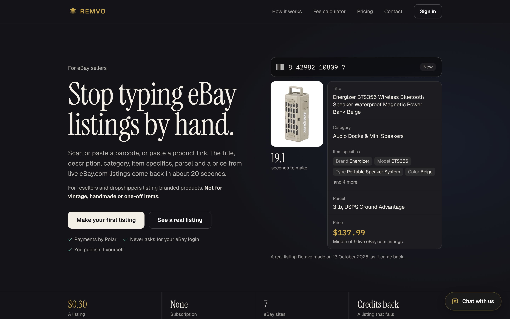
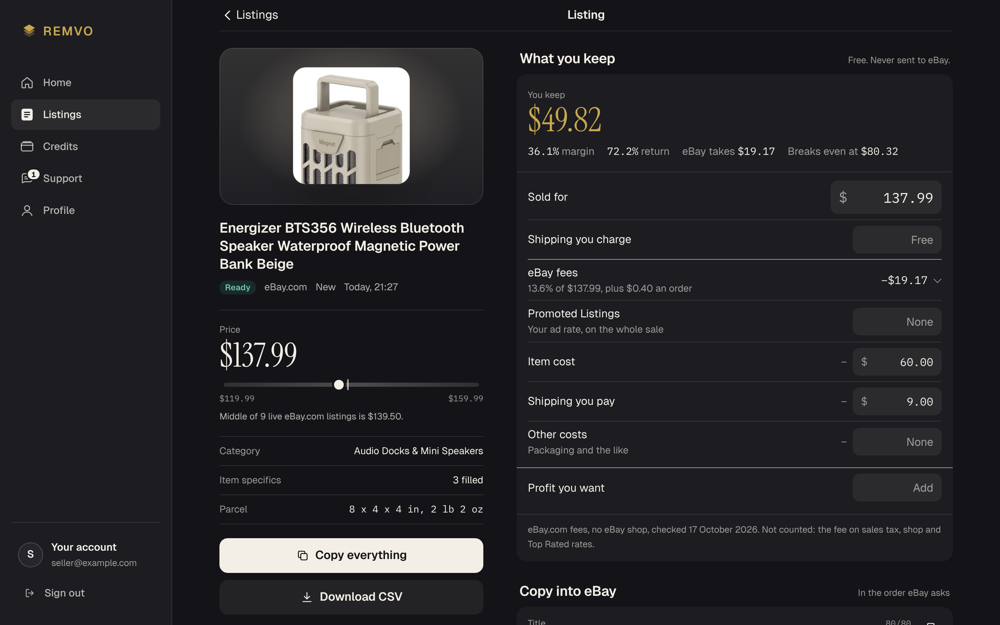
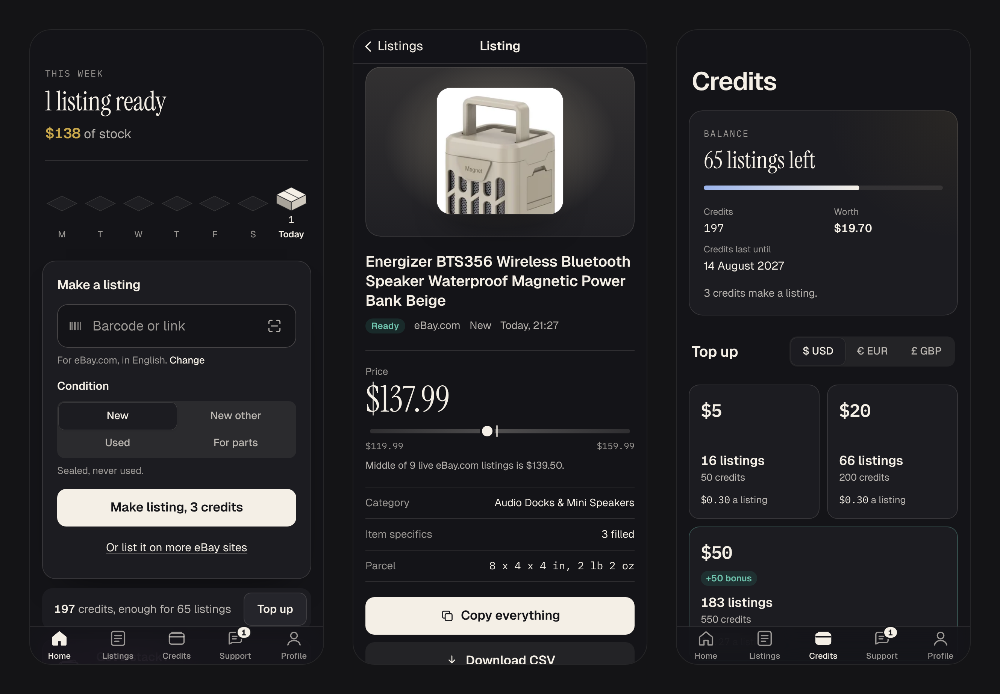
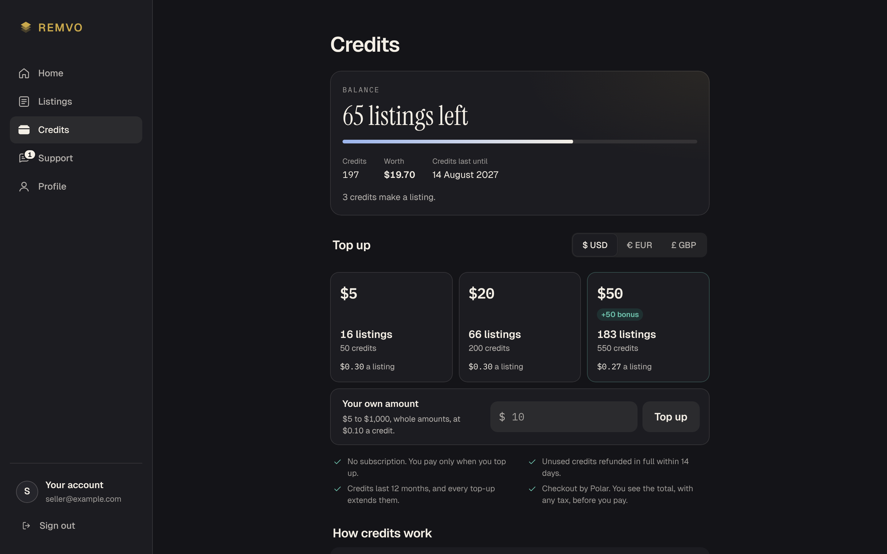
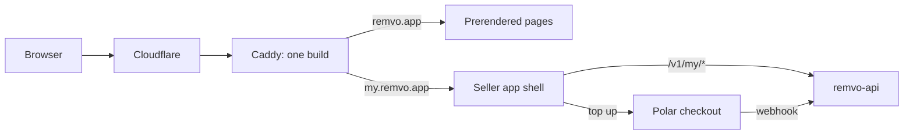

# Remvo

Paste a product's barcode or product link and get a finished eBay listing: title, description, category, item specifics, parcel and a price taken from live eBay listings.

Live at: [remvo.app](https://remvo.app) (website) and [my.remvo.app](https://my.remvo.app) (the app)

This repository is the web front end: the public website and the seller app. The API is a separate repository.

## What it does

Resellers and dropshippers often list the same branded products over and over. For each one they have to write a title that fits eBay's limit, find the right category, fill in the item specifics, work out the parcel size and check what the product sells for. Remvo does all of that in about twenty seconds and lays the result out so each field can be copied straight into eBay.

The seller enters a barcode or a product link, or scans the barcode with the phone's camera, and picks a condition. If more than one product matches, the app asks which one. Every finished listing is kept for 90 days with a link back to its source product, and it can be edited, copied field by field or downloaded as CSV. It also shows what the seller keeps after eBay's fees and their own cost.

- **Bulk listing** takes up to 500 products at once: pasted, uploaded as a CSV, typed with a barcode scanner or scanned with the camera. The result is an eBay drafts file plus a full CSV.
- **More eBay sites:** one product can be listed on up to seven eBay sites at once, each in that site's language, with a local price and parcel and a comparison of where it brings in most.
- **Free fee calculators** for eBay.com and eBay.co.uk live on the public site.
- **Live chat** with a person, inside the app and on the site.

There is no subscription. Sellers buy credits: a listing costs 3, and seven sites cost 15. Payments go through Polar, so Remvo never handles card details and never asks for the seller's eBay login.

## Screenshots









## How it is built

The build is one React single-page app that serves four hostnames. `App.jsx` picks a router from the hostname: `remvo.app` gets the website, `my.remvo.app` the seller app, and `admin.` and `pay.` get trees from Remvo's earlier product, which are paused but still hosted. Each tree is lazy-loaded, so a visitor only downloads the code for the host they are on.

The website pages are rendered to real HTML at build time. The seller app is a client-side app that talks to `api.remvo.app` with cookie sessions. Caddy serves the whole `dist/` folder: prerendered pages for the website, and the app shell for the app hosts.



## Engineering notes

**Search engines and a single-page app.** A plain single-page app gives Google an empty `<div>`. After `vite build`, a second server build renders every page listed in `src/lib/seo.js` to `dist/<path>/index.html`, each with its own title, canonical address, Open Graph tags and structured data. The step also writes the stylesheet and script preloads for the website chunk and a sitemap. If the HTML template has lost a marker the step relies on, the build fails, so a page can never ship without its text. Caddy serves these pages with a real 404, gives app hosts `noindex` and a blocking `robots.txt`, and never serves the app shell on the public site.

**One build, four hosts, no shared weight.** The router is chosen by hostname before anything renders, and each tree sits behind its own `lazy()` import, so Rollup emits a separate chunk per host. The website never loads code from the app or the paused trees. In development, `?my`, `?admin` and `?checkout` switch trees without editing the hosts file. `?my` is remembered in localStorage, so a reload or a new tab stays in the app; `?site` goes back to the website.

Inside the seller app, every signed-in screen sits in one chunk. It starts loading at the same moment as the session check, and the app waits for both once, so a deep link paints in one step instead of a chain of lazy loads. The sign-in page fetches that chunk while the browser is idle.

**Money that arrives by webhook.** When a seller returns from Polar, the payment is done but the credits have not landed yet, because they are only added when the webhook reaches the API. The Credits page checks every two seconds and says when the credits are in. After 45 seconds it tells the seller plainly that the payment is safe and the credits will appear by themselves, instead of showing an error.

**Listings that finish while you look elsewhere.** One small store per signed-in account holds the listings and is shared by every screen. A listing still being made is checked every second until it is ready or failed, so a seller who leaves the progress screen still sees it finish in Listings. Edits show immediately, save in the background and roll back if the save fails. The credit balance refreshes whenever a listing is made or fails, because both move credits.

**Barcodes read on the phone.** Scanning uses the browser's own barcode reader where there is one (Chrome on Android). Elsewhere, including iPhone, it uses ZXing compiled to WebAssembly, served from Remvo's own address and fetched only when the camera is opened. Each read must pass its check digit. A UPC read as a 13-digit EAN loses its leading 0, so the same product is never added twice. The camera's picture never leaves the device; only the number goes into the box. For one listing the camera closes after the first good read and nothing is spent until the seller taps Make. In bulk, each new barcode lands on its own line.

**A back button that knows where you came from.** The app records which path sits at each position in the tab's history, using React Router's own history index. If the screen a back button names is the one just behind, it goes back in history and the list returns to where it was scrolled. If the seller arrived from a shared link, the button opens that screen fresh instead of leaving the app.

## Stack

- **Front end:** React 19, Vite 6, React Router 7, CSS Modules, Motion, SimpleWebAuthn (passkeys), barcode-detector (ZXing in WebAssembly)
- **Sign-in:** email and password, emailed codes and passkeys, including passkeys suggested in the email field
- **Serving:** Caddy 2 on self-hosted Coolify, behind Cloudflare
- **Back end (separate repository):** Node.js, Express, PostgreSQL
- **Payments:** Polar, as merchant of record

## Running locally

Needs Node 20 or later, and remvo-api running on `localhost:8080` for real data.

```bash
npm install
npm run dev            # http://localhost:5173 is the website
                       # http://localhost:5173/?my is the seller app (?site goes back)
```

The seller app also runs without the API, on built-in sample data:

```
/?data=worst   every field at its realistic worst
/?data=empty   a new account
/?data=one     one of everything
/?data=huge    1,200 listings and a 500-line batch
/?data=real    back to the real API
```

Production build, including the prerendered pages:

```bash
npm run build
caddy run --config Caddyfile --adapter caddyfile   # serves dist/ on $PORT (default 3000)
```

Environment variables, all optional:

| Variable | What it does |
|---|---|
| `VITE_API_URL` | API address for the seller app. Defaults to `localhost:8080` in development and `api.remvo.app` in production |
| `VITE_APP_TARGET` | `seller` forces the seller app regardless of hostname |
| `PORT`, `REMVO_WEB_ROOT` | Caddy's port and the folder it serves |

Built by Remvo Labs Limited, Lagos.
